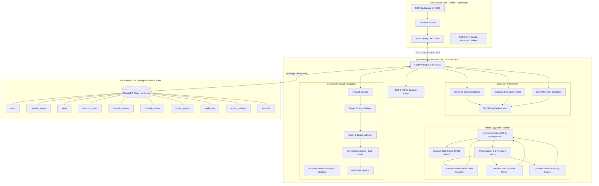
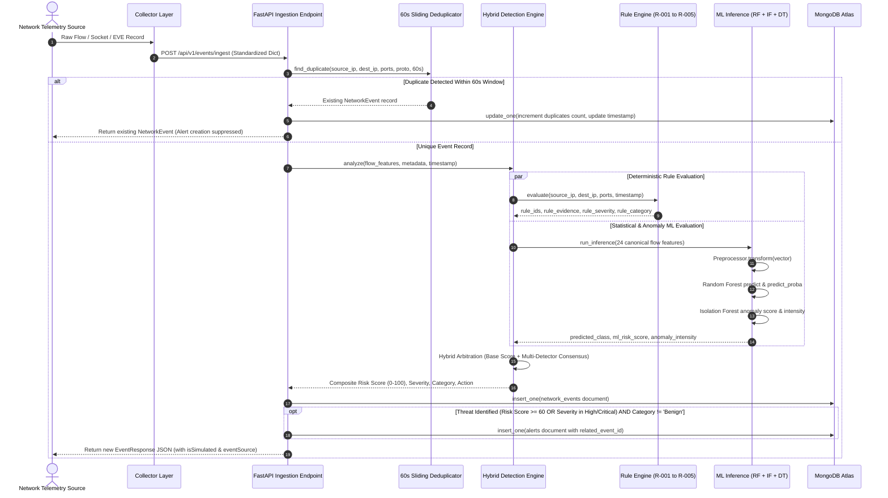
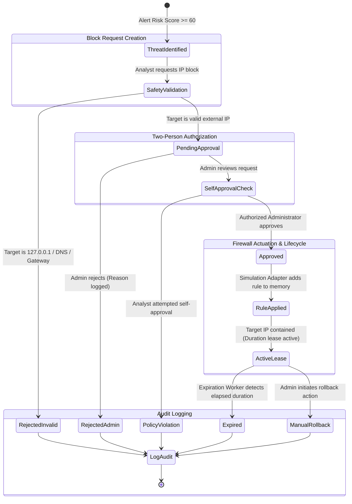
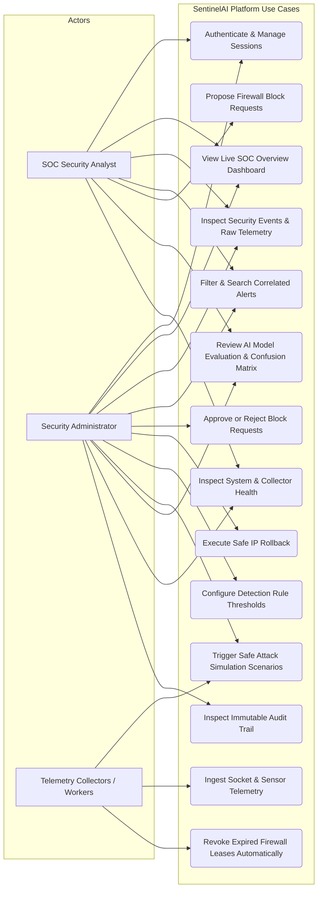

# SentinelAI — System Architecture & Workflow Diagrams

This document contains the official architectural, data flow, and workflow diagrams for **SentinelAI — AI-Powered Firewall Attack Detection System**. All diagrams are written in standard Mermaid specification and accurately reflect the system's codebase.

---

## 1. Overall System Architecture

This diagram illustrates the 3-tier structure of SentinelAI, depicting the Presentation Tier (React + Vite), the Application Tier (FastAPI, Detection Engine, and Background Workers), and the Persistence Tier (MongoDB Atlas).



---

## 2. Event Ingestion and Hybrid Detection Flow

This sequence diagram details the end-to-end lifecycle of a network event, from telemetry ingestion and sliding-window deduplication to hybrid arbitration and correlated alert creation.



---

## 3. MongoDB Persistence and API Data Flow

This diagram illustrates how client requests traverse route controllers, repositories, and MongoDB Atlas collections, highlighting the secure credential boundary.

```mermaid
graph LR
    subgraph Client [Client Dashboard]
        FE[React Components]
    end

    subgraph API_Layer [FastAPI REST Routes]
        R_Events[/api/v1/events]
        R_Alerts[/api/v1/alerts]
        R_Rules[/api/v1/rules]
        R_FW[/api/v1/firewall]
        R_Analytics[/api/v1/analytics]
        R_Health[/api/v1/health]
    end

    subgraph Service_Repository_Layer [Service & Repository Layer]
        S_Evt[EventService / EventRepository]
        S_Alt[AlertService / AlertRepository]
        S_Rul[RuleService / RuleRepository]
        S_FW[FirewallService / FirewallRepository]
        S_Ana[AnalyticsService]
        DBMgr[MongoDBManager Singleton]
    end

    subgraph Mongo_Atlas [MongoDB Atlas Cloud Cluster]
        coll_events[(network_events)]
        coll_alerts[(alerts)]
        coll_rules[(detection_rules)]
        coll_fw_req[(firewall_requests)]
        coll_fw_act[(firewall_actions)]
        coll_audit[(audit_logs)]
        coll_models[(model_registry)]
    end

    FE <--> |JSON API Requests| API_Layer
    R_Events <--> S_Evt
    R_Alerts <--> S_Alt
    R_Rules <--> S_Rul
    R_FW <--> S_FW
    R_Analytics <--> S_Ana
    R_Health <--> DBMgr

    S_Evt <--> DBMgr
    S_Alt <--> DBMgr
    S_Rul <--> DBMgr
    S_FW <--> DBMgr
    S_Ana <--> DBMgr

    DBMgr <--> |PyMongo TLS Encrypted Pool| Mongo_Atlas
    Mongo_Atlas --- coll_events & coll_alerts & coll_rules & coll_fw_req & coll_fw_act & coll_audit & coll_models
```

---

## 4. Controlled Firewall Request, Approval, and Rollback Workflow

This stateful workflow diagram models the Human-in-the-Loop (HITL) firewall containment process, demonstrating strict boundary checks, role separation, and automatic lease expiry.



---

## 5. Project Use-Case Diagram

This diagram outlines the functional use cases available to the three primary actors in the SentinelAI ecosystem: SOC Analyst, Security Administrator, and System Collectors/Workers.


