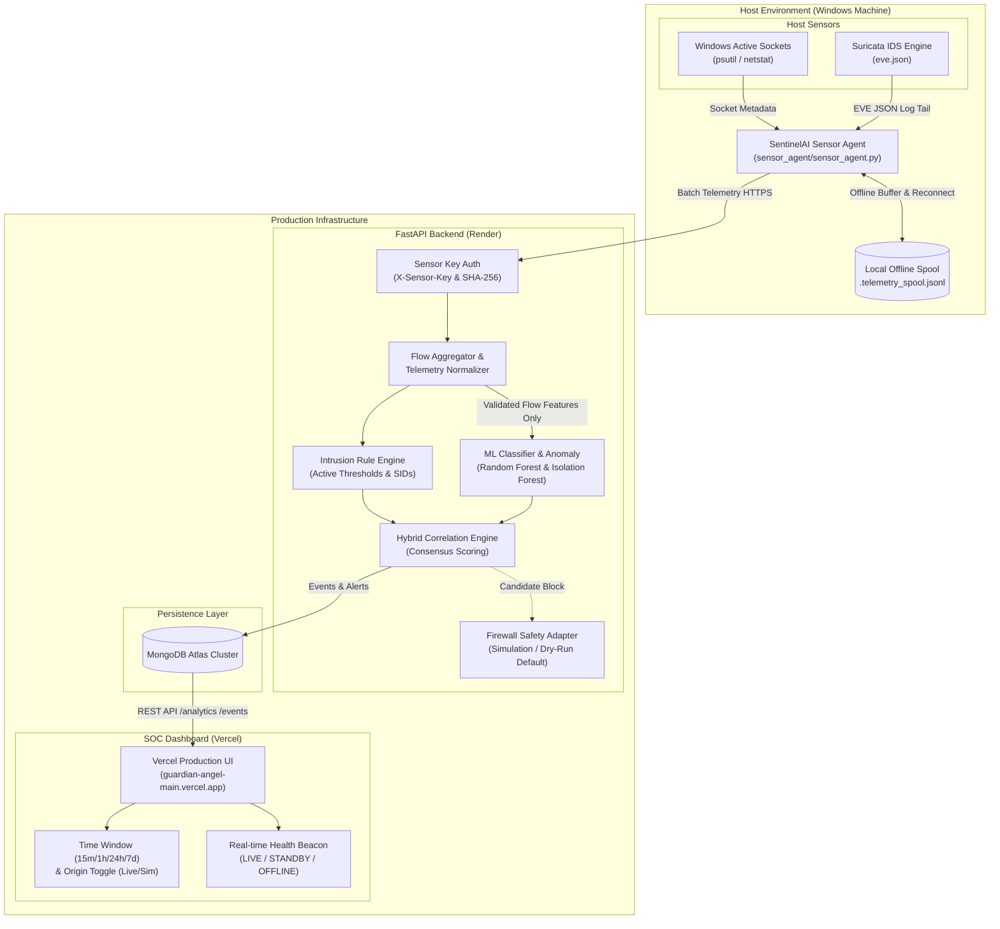

# SentinelAI Real Network Monitoring Architecture

## 1. Executive Summary

SentinelAI has transitioned from an initial prototype and simulation interface into a production-grade, genuine network intrusion detection and security operations monitoring system. Genuine host and network telemetry is collected at the endpoint, streamed over authenticated HTTPS/HTTP, normalized without feature fabrication, correlated against active intrusion detection rules and ML models, and visualized in real time on the Security Operations Center (SOC) dashboard.

---

## 2. High-Level System Architecture

---

## 3. Real Telemetry vs. CICIDS2017 Feature Matrix

Machine learning models trained on benchmark datasets (such as CICIDS2017) rely on bidirectional flow features calculated across full packet capture (PCAP) streams. Real endpoints produce different tiers of telemetry depending on whether full packet inspection or socket monitoring is active:

| Telemetry Dimension | Windows Active Sockets | Suricata EVE Flow Logs | CICIDS2017 Feature Schema | SentinelAI Handling |
| :--- | :--- | :--- | :--- | :--- |
| **Local / Remote IP** | ✅ Genuine (`psutil`) | ✅ Genuine (`src_ip`, `dest_ip`) | `Source IP`, `Destination IP` | Normalized directly into `NetworkEvent` |
| **Ports & Protocol** | ✅ Genuine (TCP/UDP) | ✅ Genuine (TCP/UDP/ICMP) | `dst_port`, `protocol` | Standardized and indexed |
| **Connection State** | ✅ Genuine (`ESTABLISHED`, etc.) | ✅ TCP Flags (`syn`, `rst`, `ack`) | `syn_flag_count`, `rst_flag_count` | Evaluated by Rule Engine |
| **Process ID & Name** | ✅ Genuine (`pid`, executable) | ❌ Not in network packet | ❌ Not available in PCAP | Enriched in `collector_metadata` |
| **Byte & Packet Counts**| ❌ Not per-socket by default | ✅ Measured (`bytes_toserver`, etc.)| `total_fwd_packets`, `total_length` | Extracted from Suricata flow logs |
| **Inter-Arrival Times** | ❌ Not available | ⚠️ Approximate (`flow.age`) | `flow_iat_mean`, `flow_iat_std` | Flow duration calculated safely |
| **ML Feature Validity** | ⚠️ `features_valid=False` | ✅ `features_valid=True` | Required for inference | ML executed only when genuine |

> [!IMPORTANT]
> **No Feature Hallucination Guarantee**: SentinelAI strictly isolates socket metadata from flow metrics. Missing packet inter-arrival times or packet length distributions are **never** filled with fabricated numbers. ML classifiers run only when genuine flow statistics exist (`features_valid=True`). Socket connections are inspected with signature and behavioral rule engines.

---

## 4. Security & Safety Model

1. **Sensor Authentication**:
   - Sensors enroll with an administrator JWT.
   - The backend returns a cryptographically secure token `sen_live_<48 hex chars>`.
   - The backend hashes the token using **SHA-256** and stores only the hash in MongoDB Atlas.
   - Sensor requests send `X-Sensor-Key` header; constant-time hash comparisons protect against timing attacks.

2. **Data Origin Isolation**:
   - All genuine telemetry is persisted with `data_origin="live"` and `is_simulated=false`.
   - Test generator runs with `data_origin="simulated"` and `is_simulated=true`.
   - Database aggregations strictly separate live counts from simulated traffic.

3. **Firewall Safety Adapter**:
   - `FIREWALL_MODE=simulation` and `ALLOW_FIREWALL_BLOCKING=false` remain strictly enforced.
   - All high-severity alerts generate block proposals in the firewall queue.
   - No destructive firewall commands are executed on the host.

